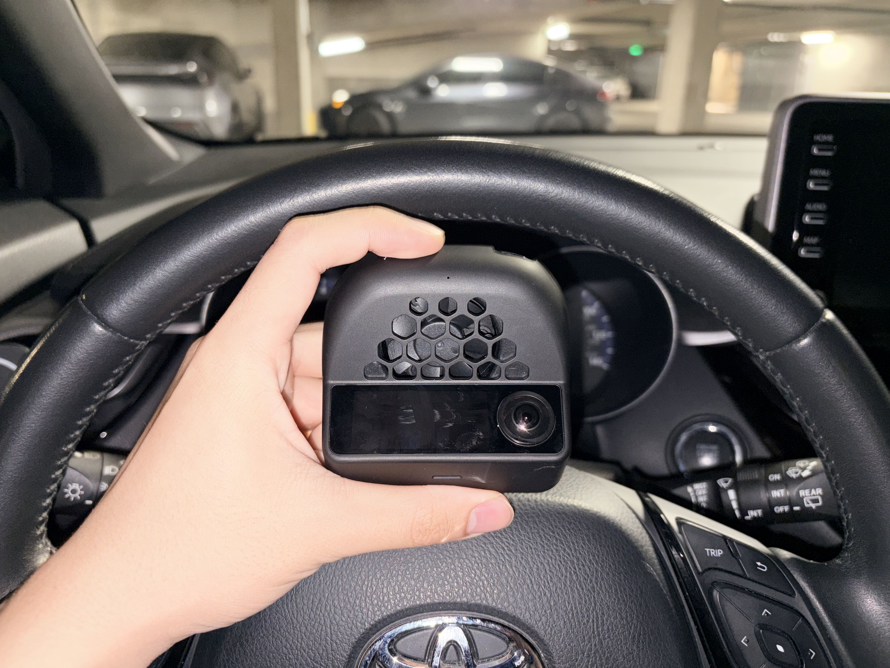
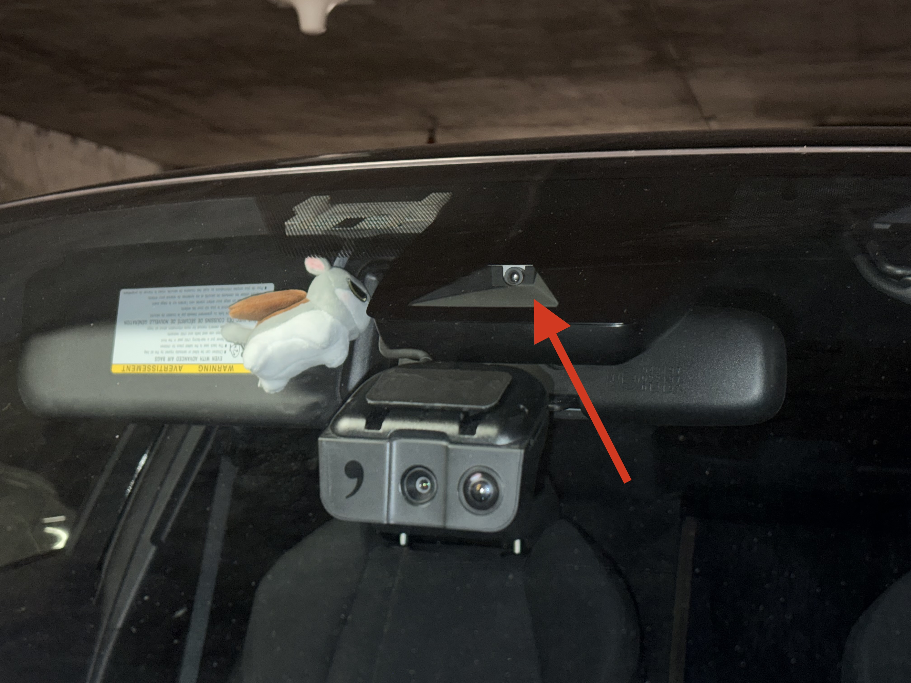
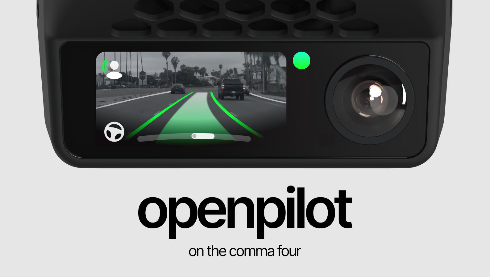

最近在洛杉矶开车开得有点心烦，突然想起来很早之前听说过的一个项目——OpenPilot。是一个开源的自动驾驶项目，可以让“老轱辘棒子”也能拥有当前名列前茅的自动驾驶能力。于是就激情下单了，到手是这么一个不到巴掌大的小设备。把它接到我的丰田车上，立刻解放了我至少 80% 的开车精力消耗，让开车从聚精会神的时刻微调方向，变成简单盯着以防它出错。

说起来，我的 22 年丰田 CHR 原车自带车道保持和车距保持功能，在美国这边叫做 ACC（自适应巡航控制）。但为什么我还要花不少钱，冒着改装的风险去使用 OpenPilot 呢？关键在于它的技术路线以及最终表现效果上的差别。

丰田的车道保持也是通过摄像头方案来识别道路标线的，在这个位置藏的一颗摄像头和计算芯片，开启 ACC 的时候会尝试识别标线，然后计算好该怎么打方向，传给方向盘。而车距控制则是通过毫米波雷达检测前车距离来控制油门刹车。

乍一听挺合理，视觉和雷达各司其职，这不挺先进的嘛。但实际用起来，体验就没那么好了。

丰田多半采用的是传统的 CV 方法去进行标线的识别，这让它只有在标线清晰、车道笔直且光照好的时候才能正常使用。也就是说，基本上只有长途跑高速的时候能开，遇到一个稍大一点的弯它就会跟丢。但就算是大直道，我们也得时刻盯着它，不知道它什么时候就会罢工，得时刻准备接管。车距控制在高速的时候体验倒是挺不错，但是一旦速度降到 30 mile以内，走走停停的时候，刹得很猛，加速又跟不上，自己在车里坐着都糟心，还不如亲力亲为开车呢。

OpenPilot 使用的是另一套方案，就是所谓的世界模型。我们就拿大家比较熟悉的 FSD 来举例：

在 FSD 的 V12 之前，整个 FSD 是由一套几十万行的 C++ 代码组成的机械化的自动驾驶。遇到什么情况就怎么操作，是由工程师的辛勤汗水与测试去实现的。

但在 V12 之后，开车的就是一个大模型。它直接从自动驾驶的视频中、从人工的操作里去学习怎么开车。这使得它有很好的泛化性，可以应付各种各样在实验室里想不出来的 corner case，就比如识别正在施工的路段，由锥桶划分出来的临时路线，或者路面上某一个从来没有在数据集里出现过的障碍物。

一样使用世界模型的 openpilot，虽然在能力上肯定不如特斯拉的 FSD，但是在识别车道这件事上，我认为它至少做到了 99% 以上的正确率。现在我只要智驾一开，基本上所有的直线行驶都可以交给它来完成。

当然它也是有局限性的。一方面 OpenPilot 现在的导航接入功能还是 alpha 阶段，不能直接看地图把我从 A 点送到 B 点，需要我打转向灯告诉它这里该变道、转弯了。另一方面这个小设备没有侧向后向的摄像头，不知道能不能安全变道，需要我观察好确认安全后轻拨方向盘，再由它完成变道。

但即便如此，它仍然能大大减轻我在拥堵的洛杉矶城区开车，或者在高速上跑远路的精力消耗。真是一次非常值得的购买，科技实实在在的改变了生活，让我们这种破丰田都能接入只能了。

回到我们的标题上，为什么说一颗手机芯片在替我开车呢？这一个巴掌大的小东西里面，实际上装的是一颗骁龙 845，是八九年前的中端手机的常用芯片。它的算力实话说相当差劲，只有大概 1 TFLOPS，和特斯拉车上那套 HW4 的算力差距可能有几百倍。

但好在我对它要求也没有那么高。我知道它是一个没有那么可靠的设备，会时刻盯着它怎么开，也会去看有没有变道条件。它依然能减少我 80% 以上的驾驶精力消耗，就像是从坐在主驾自己开车，变成坐在一个新手司机的副驾指导他怎么开车。

或许之后等主播告别了自己这辆老轱辘棒子，也会去换一辆最新的特斯拉，去感受一下当前最强的自动驾驶是什么个情况，有机会再向读者们汇报！
